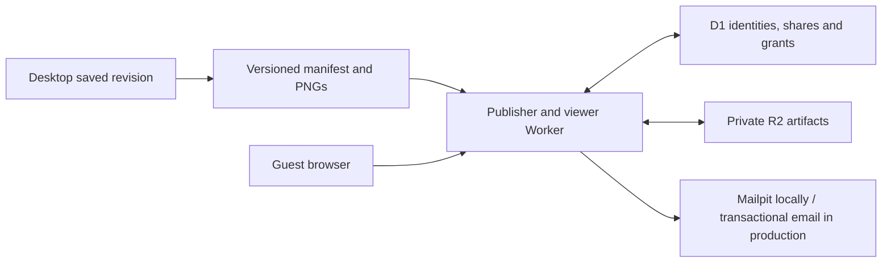

# Web sharing architecture

Status on November 15, 2026. Architecture proposal with Security input. The desktop remains the source of truth. A loopback viewer prototype is available. Cloudflare integration and deployment are pending.

## Local page sync slice — November 23, 2026

The implemented local slice uses a Cloudflare Worker with D1 metadata/waitlist storage, R2 PNG snapshots, and the existing TanStack Router client. Settings exports the visible page through a generation-checked, main-frame-only IPC method. The export pins one project snapshot, renders only that page, refuses unresolved dependencies, and sends a strict manifest with verified PNG members. No source files, local paths, credentials, other pages, tokens, or command receipts are exported. This does not change the project format or its command history.

For this slice, the requested stable URL replaces the earlier proposal's new-link-per-revision behavior: `(projectId, pageId)` identifies one `/p/<id>` route. Each successful sync points it to a new immutable snapshot. D1 publication follows all verified R2 writes; a failed upload or lower source revision leaves the prior pointer intact. Old published image URLs still resolve to their original snapshot. This is a manual snapshot sync, not a live editor connection.

Publishing is local-only and capability-authenticated. The main process accepts only a configured HTTP loopback origin, constructs links from validated IDs, and refuses redirects. The Worker rejects browser-origin publishing requests and disables these local endpoints on hosted origins. The capability stays in private development configuration. The public viewer receives only page presentation metadata and images. Its CSP disables frames, scripts from other sites, and remote asset loading. Waitlist requests require same-origin JSON, normalize emails, and deduplicate with a D1 primary key; no email is echoed into responses or logs.

`cf` and Cloudflare Vite plugin v2 use `cloudflare.config.ts`, generated binding/runtime types, and local persistence. Frontend and Worker TypeScript configurations are separate to avoid conflicting DOM/runtime globals. The launcher keeps the development registry within the checkout and uses polling where native file watching is unavailable. [Local setup and verification](../apps/web/README.md)

The remaining sections describe the broader hosted proposal. Production publishing authentication, account ownership, real resource configuration, waitlist abuse controls, revocation/retention, and CI deployment are next decisions; the local capability is not a hosted authentication design.

## What a link opens

| Mode | Recipient experience | Published scope |
| --- | --- | --- |
| Project canvas | Page picker, pan, zoom, fit, and jump to an artboard. Use the saved page order and artboard positions. | The selected committed project revision, including all its pages and artboards. Show the full scope to the publisher before upload. |
| Artboard | One artboard at its saved viewport, with fit and actual-size controls. | That artboard only, including the resources required to show it. |
| Device frame | The same artboard view, optionally presented in generic phone or laptop chrome. | The artboard and a frame choice. Device chrome is trusted viewer UI. It scales with the displayed artboard and keeps the original CSS viewport. |

Offer plain and password-protected links. A guest can open either mode without an account. The project owner uses an email magic link for publishing and managing shares. Start with an owner email allowlist. Each share opens the same revision until its owner revokes it or its expiry passes. Sharing newer work creates a new link. Changing a link password invalidates previously unlocked sessions for that link. A downloaded copy can outlive revocation.

## Services and boundaries

- Add a small React and Vite web app in the repo. Serve the trusted viewer and publisher shell with Workers Static Assets. The Worker handles sign-in, upload, delivery, expiry and revocation. Only the app bundle and decorative device frame assets are public static files. Route gated paths through the Worker before any static asset routing. [Cloudflare Vite plugin](https://developers.cloudflare.com/workers/vite-plugin/) · [Workers Static Assets routing](https://developers.cloudflare.com/workers/static-assets/binding/#run_worker_first)
- Use D1 for publisher identities, login challenges, sessions, upload intents, shares, and guest grants. Use a private R2 bucket for published manifests and artifact bytes. Address objects by publish ID and declared digest. Keep R2 public access disabled. The viewer receives routes to authorized artifacts through the Worker. Use primary D1 reads for authorization and revocation. [D1 database binding](https://developers.cloudflare.com/d1/worker-api/d1-database/) · [D1 primary reads](https://developers.cloudflare.com/d1/best-practices/read-replication/) · [R2 Worker binding](https://developers.cloudflare.com/r2/api/workers/workers-api-reference/)
- Start with desktop-generated PNG captures. They keep preview appearance, protect the reader from arbitrary uploaded HTML and CSS, and make the first public link simple to verify. Later, offer live HTML/CSS on a dedicated cookieless preview site, using the existing inert artboard policy as the starting point. Whole-canvas mode can stay on PNG thumbnails and load a full-size view on demand. [Desktop preview boundary](decisions/0003-preview-and-mcp.md)
- Publish is an explicit owner action in desktop or the publisher shell. A browser session can upload bounded, typed artifacts from a desktop export in the first slice. A future desktop sign-in handoff can use the system browser and a short-lived, one-time pairing exchange scoped to publishing. Desktop files, MCP access, and local agent credentials remain on the machine. [Project selection and local authority](decisions/0004-project-selection.md) · [Product invariants](invariants.md)

## Snapshot and commit contract

1. Pin one immutable project snapshot and its activation-owned asset and token bytes in desktop main. Render every selected board from that snapshot through the existing capture service. The project can continue accepting edits during the capture. Retiring the activation cancels work that has yet to finish. Export a separate versioned sharing manifest. Record export schema version, selected scope, source project revision, page and artboard order where needed, artboard dimensions and positions, media context, and digests for the exact captures. Include source, asset and token digests for verification. Record a bounded render status for each capture. Fail with the specific artboard or dependency if the requested set cannot be captured consistently. Show the owner a preview and the scope before publishing. [Desktop commit contract](decisions/0002-project-commits.md) · [Capture identity](decisions/0003-preview-and-mcp.md)
2. From a trusted publishing session, allocate a pending intent with a publisher-scoped idempotency key and a fingerprint of the requested manifest and access mode. Send each declared object under its own size and count limits. Validate the schema, file type, checksum, viewport dimensions and scope. Start with typed manifest and PNG uploads instead of a general archive or directory import. Reject unsupported schemas and malformed, missing, or unexpected objects. Keep local file names outside tenant storage addressing. Only export the data the web viewer needs. A single-artboard manifest omits other pages, projects, assets, undo history, MCP receipts, caches, credentials and local paths.
3. Store verified objects under private, unique keys with create-once writes. A successful, conditional D1 publication transaction is the point at which the share becomes visible. It pins the manifest and the complete object member set. An interruption before that transaction exposes no share. Equal retries reuse their recorded result, including after commit and a lost response. A changed payload with the same idempotency key is rejected. Missing data after commit is an explicit unavailable error. Clean abandoned loads only after atomically retiring their pending intent and waiting for admitted writes to finish. A live share cannot reference an abandoned upload. [R2 read-after-write and caching](https://developers.cloudflare.com/r2/reference/consistency/) · [D1 transactional batches](https://developers.cloudflare.com/d1/worker-api/d1-database/#batch)
4. For whole-project browsing, use the saved page and board model in a read-only viewer. Load visible thumbnails first, then the selected artboard. Keep the canvas camera independent of artboard width and height. For phone or laptop styling, wrap the same viewport or capture in trusted CSS with fit scaling. Treat an optional phone shape as presentation rather than a request to recapture at a different breakpoint. If the publisher wants a different viewport, resize the artboard on desktop and publish that revision. [Viewport and camera invariants](invariants.md)

## Share access

- Use an unguessable share secret carried in the URL fragment and a separate public route ID. The trusted page reads the secret, clears it from the address bar, and exchanges it with the Worker using same-origin POST. Give the browser an opaque, host-only Secure HttpOnly SameSite guest cookie with short-lived, server-side grants keyed by share. Keep that cookie separate from publisher authority. Store the secret's purpose-bound digest. Reopening the link in another browser starts a new guest grant. The publisher can rotate the secret and copy a fresh link. Keep the original secret in the publisher's trusted UI long enough to copy it and retry the same publish request. Show generic unauthenticated responses and use a generic link preview so unfurlers learn no private project metadata.
- Password protection adds a separate secret to the link exchange. Use a salted, audited adaptive verifier such as Argon2id. Benchmark the chosen implementation on the deployed Worker tier before offering the mode. If it does not fit, select a compatible verifier or dedicated service before releasing passwords. Rate-limit before password verification. Use a global per-share budget backed by an atomic database admission check plus an edge per-IP guard. Password changes and revocation advance the share's access epoch. Expiry is checked independently on each request. Keep grant IDs and secrets away from project files and diagnostics. [OWASP password storage guidance](https://cheatsheetseries.owasp.org/cheatsheets/Password_Storage_Cheat_Sheet.html) · [Worker CPU limits](https://developers.cloudflare.com/workers/platform/limits/#cpu-time) · [Rate limit scope](https://developers.cloudflare.com/workers/runtime-apis/bindings/rate-limit/#accuracy)
- Check the grant, share, access epoch, immutable snapshot membership, and expiry on a fresh authoritative D1 read, before fetching any gated object. This applies to view metadata, artboard images, HEAD and range requests. Disable CDN caching for gated routes and return `Cache-Control: private, no-store`, including on failures and redirects. Keep R2 direct download routes private. Redact secrets and raw credentialed URLs from edge logs, app logs, traces and browser telemetry. The viewer's next fetch must fail after a revoke, even if an instance served the same URL successfully a moment earlier. [D1 read replication](https://developers.cloudflare.com/d1/best-practices/read-replication/) · [Cloudflare cache-control behavior](https://developers.cloudflare.com/cache/concepts/cache-control/)

### Live HTML/CSS extension

Introduce a second, cookieless site, preferably a separate registrable domain, before serving exported HTML/CSS. The viewer shell embeds a script-free, opaque-origin iframe. Sandbox the preview response itself so direct loads remain confined. Apply restrictive CSP with explicit preview namespace resource rules and viewer-only `frame-ancestors`. Strip executable markup, forms, navigation and embeds with a parser. Canonicalize resource paths and authorize them against the selected board and manifest. Accept only vetted media types and project-local image or font references. Block remote requests and never deliver a raw file tree. Qualify SVG separately before accepting it. Keep layout controls, device chrome, error states and viewer telemetry on the trusted site. [HTML iframe sandbox](https://html.spec.whatwg.org/multipage/iframe-embed-object.html#attr-iframe-sandbox) · [Content Security Policy](https://www.w3.org/TR/CSP3/) · [Desktop preview policy](decisions/0003-preview-and-mcp.md)

Use short-lived URL-path grants for preview documents and their scoped subresources, with fresh D1 authorization every time. Bind each grant to the parent share, snapshot, allowed board, access epoch and expiry. This keeps asset loading independent of third-party cookie availability. Keep raw grant paths out of edge logs and referrers. Harden CSP and path mapping against untrusted CSS fetches, URL traversal and cross-board resource reads. Deploy live preview only after direct-load, embedded, revocation and cookie-free Chrome and Safari cases pass. A renderer fallback can still show the pinned capture if an artboard's live preview fails.

## Magic-link sign-in

1. Use the same request and verification flow locally and in production. Start with a configured publisher allowlist. Return the same response for unknown, disallowed and eligible email addresses. Apply a global per-address delivery budget backed by atomic D1 writes and an edge per-IP guard. Use the configured app origin to create links and allow only internal navigation after sign-in. Keep mail delivery failures in redacted logs that owners can use to diagnose the path. [OWASP email token guidance](https://cheatsheetseries.owasp.org/cheatsheets/Forgot_Password_Cheat_Sheet.html) · [Workers rate-limit scope](https://developers.cloudflare.com/workers/runtime-apis/bindings/rate-limit/#accuracy)
2. Generate 256 bits of randomness. Persist a purpose-bound digest with account identity, expiry and the hash of a short-lived browser initiation cookie. Link GET and HEAD requests show a minimal Continue screen and leave the challenge unused. The screen reads the fragment locally, clears it, and submits it on explicit Continue with same-origin validation and the initiation context. This prevents ordinary scanner requests from consuming a valid link. Start with a same-browser flow and show a clear recovery prompt if the recipient opens the email in a different browser. Exclude link tracking and third-party scripts from the redemption page.
3. Atomically consume the challenge and create the opaque publisher session in one primary D1 transaction. A conditional insert reads only an unused, unexpired challenge for the initiating browser and enabled publisher, then marks it consumed only if that session was inserted. Enforce one session per challenge. Concurrent redemption yields at most one winner. A failed transaction leaves the challenge eligible for retry. Set a Secure, HttpOnly, host-only SameSite session cookie and keep only its token digest server-side. Check the account and session on each management operation, protect writes against cross-origin requests, and revoke the session on logout. Browser refusal of a cookie or a lost redemption response can require a fresh link. [D1 transactional batch](https://developers.cloudflare.com/d1/worker-api/d1-database/#batch)
4. For day-to-day local development, use a loopback-only Worker with simulated D1 and R2 and a loopback Mailpit inbox. The local sender can post to Mailpit's Send API, which avoids requiring the Worker to speak SMTP. The test runner retrieves the message from the inbox and follows the real redemption path with a synthetic allowlisted account. Local HTTPS should exercise production cookie attributes. If a development profile uses loopback HTTP, keep any cookie accommodation in that profile. The production build selects a separate sender and rejects test configuration. [Cloudflare Vite development](https://developers.cloudflare.com/workers/vite-plugin/) · [Local D1](https://developers.cloudflare.com/d1/best-practices/local-development/) · [Local R2](https://developers.cloudflare.com/r2/local-development/) · [Mailpit test inbox API](https://mailpit.axllent.org/docs/api-v1/)
5. In production, prefer Cloudflare Email Sending behind a small mail adapter if the account and verified sending domain qualify. It is currently documented as beta. A transactional email provider with validated deliverability is a fallback. Staging uses its own origin, D1, R2, secrets and sender limits. Qualify live delivery and the real browser redemption path with an authorized staging inbox. Cloudflare's local email binding also offers synthetic delivery for isolated tests. Its saved messages contain the login URL, so keep the local mail sink or simulator artifacts outside source control and production logging. [Cloudflare send bindings](https://developers.cloudflare.com/email-service/configuration/send-bindings/) · [Cloudflare local email simulator](https://developers.cloudflare.com/email-service/observability/local-development/sending/) · [Email domain authentication](https://developers.cloudflare.com/email-service/concepts/email-authentication/)

## Loopback viewer prototype

Run `pnpm web:start` with the repository's Node.js 24 toolchain and visit [127.0.0.1:8787](http://127.0.0.1:8787). The [local demo](../apps/web/README.md) exercises same-browser magic-link redemption through a browser test inbox, guest link grants and revocation, whole-canvas pan and zoom, and single-artboard phone and laptop frames. It uses one checked-in synthetic revision, local Node.js and in-memory SQLite. The fixture iframes have an opaque origin and deliver only known static HTML. The production release continues to start with PNG uploads.

## Build order and release evidence

| Slice | Completion evidence |
| --- | --- |
| 1. Local single-artboard share | Stand up the web shell with a synthetic fixture. Open a magic link from Mailpit, publish one versioned manifest and PNG to private R2, open the guest URL in a fresh browser, and revoke it. Verify interrupted upload and equal retry, stale schema, wrong publisher, absent grant, viewport and capture digests, scanner GET and concurrent replay. |
| 2. Desktop export and canvas viewing | Export one real disposable desktop revision. Share one artboard and the whole project independently. Reproduce the saved page layout, fit and pan, verify that the single-artboard link reveals no other board, and test phone and laptop chrome around unchanged viewport dimensions. Bounded thumbnail performance evidence covers the largest supported share. |
| 3. Production qualification | Deploy the raster viewer to an isolated staging environment. Confirm DNS and HTTPS, staging mail delivery and cookie settings, no private assets on public hosts, authoritative revocation after CDN warmup, data migration and rollback, redacted telemetry, and recipient access on desktop and mobile browsers. Production deployment follows staging evidence and a decision on owners, origins and mail provider. |
| 4. Optional password and live preview | Password checks cover verifier cost, attempt throttling, password rotation, expiry and replay. Live preview checks cover direct navigation, iframe isolation, asset scope, remote fetch blocking, grant leakage and revocation on a cookieless origin. Each feature can follow independently once its evidence passes. |

The next bounded task is slice 1 with a synthetic PNG and a plain owner allowlist. Architecture and Reliability owns the export and publication contract. Security owns access, authentication, and preview boundaries. Infrastructure owns staging and mail delivery. Frontend and Design own the responsive reader, device frames and share prompts. A temporary SQLite model verified one successful redemption across eight concurrent attempts. It also verified rollback followed by retry and rejection of expired, wrong-browser, and disabled-owner challenges. Worker and browser evidence remains in the build-order table.
